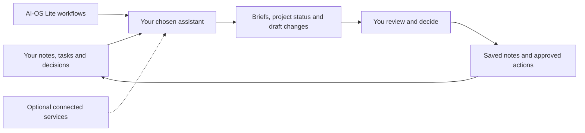

# AI-OS Lite [](https://discord.gg/9axRtknSY)

**AI-OS helps you organize your knowledge and put it to work with AI.**

Keep your projects, decisions, sources and useful history in files you own. Give your assistant that context to help connect related work, think through a situation and choose your next step. AI-OS Lite provides the workspace structure, templates and skills to help you build and reuse that context. You choose the supported assistant, the information it can access and the changes it may make.

AI-OS Lite is the public edition, built by [RS42](https://rs42.ai/). This repository includes workspace setup from [Vault Setup Kit](docs/setup.md), starter content, templates and eleven assistant skills.

[Website](https://rs42.ai/) · [Quick start](#quick-start) · [Worked example](docs/first-use.md) · [Documentation](docs/README.md)

## What you can do

- **See how the pieces connect.** Ask your assistant to bring related projects, earlier decisions and useful knowledge into your current question.
- **Put an idea to work.** Explore how something you have learned relates to your goals, then choose a project or next step worth pursuing.
- **Prepare with the history in view.** Use notes from earlier conversations to help explain a proposal, recall commitments or work through a complicated situation.
- **Learn from your own work.** Revisit recorded decisions and experiences, explore possible patterns, and decide what rings true.
- **Spend less time filing.** Ask your assistant to organize and link useful notes using the workspace's rules, so you can focus on the ideas and decisions.

## Quick start

The primary path is a local workspace on macOS. You need Git, Bash, Python 3.10+ and `jq`, and an authenticated [Claude Code](https://code.claude.com/docs/en/overview) or [Codex](https://developers.openai.com/codex/) installation. The AI account is separate from AI-OS Lite. [Obsidian](https://obsidian.md/) is an optional way to browse your files and dashboard views; the assistant can use the files directly.

**1. Get AI-OS Lite and create your workspace.** Run these commands in your terminal:

```bash
git clone https://github.com/RS42-AI/ai-os-lite.git
cd ai-os-lite
bash setup/setup-vault.sh "$HOME/AIOS"
```

This creates folders, starter notes, templates and workspace instructions directly in `~/AIOS`. Read `Personal/2. Projects/Vault-Setup/Vault-Setup.md` in your assistant or Markdown editor. See [setup](docs/setup.md) for a combined installer, optional Obsidian plugins and the Windows/WSL path.

**2. Add the assistant skills.** From the same `ai-os-lite` directory, choose the helper for your installed assistant. It installs the workflows included with this copy of AI-OS Lite:

```bash
# Choose the helper for your installed assistant.
AI_OS_LITE_MARKETPLACE="$PWD" bash setup/setup-codex-plugins.sh "$HOME/AIOS"
# Or:
AI_OS_LITE_MARKETPLACE="$PWD" bash setup/setup-claude-plugins.sh "$HOME/AIOS"
```

Open `~/AIOS` as the assistant's workspace and start a fresh session so the skills load. Check the helper output: a created vault does not mean the assistant plugin was installed successfully.

**3. Give your assistant some useful context.**

```text
Run setup-context in this workspace. Help me choose one outcome and
connect it to an area, goal, project and next task. Offer a fictional example
or let me skip. Show proposed notes before saving; ask separately about
any instruction-file changes.
```

In Claude Code invoke `/ai-os-lite:setup-context`; in Codex, use `Run $setup-context.` The conversation reuses your existing context and asks only for the missing choices. Personalization is optional: your files and skills can be installed without sharing personal goals. The [setup guide](docs/setup.md) explains the current instruction review and [first-use checks](docs/first-use-acceptance.md).

Already have a vault or installed Vault Setup Kit? Follow the [existing-user transition](docs/existing-users.md) before running setup against your real notes.

## How it works

An AI-OS workspace is a folder of Markdown notes and supporting configuration. AI-OS adds a consistent way to connect that context and skills that teach your assistant how to use it. You can keep the files, move them, and give another supported assistant access when you choose. Chat history and assistant accounts do not transfer automatically.

The structure gives useful context a place to live. The instructions and skills give your assistant a method: check existing knowledge, route notes consistently, connect goals and projects, and identify changes that need your decision. Templates and checks help keep the records usable as they grow. You bring the ideas and judgment; the assistant helps organize the record and reason from it.



The workflows are manually invoked. Installing Lite does not install a scheduler, a hosted AI team or a service that continuously collects your information. [Data and control](docs/data-and-control.md) explains where files live and what your assistant's provider can receive.

## A first useful example

Once you have added a few notes about a project, try this illustrative prompt:

```text
Use the notes I have selected for this project to explain what we already know,
which earlier work is relevant, and what a useful next step could be.
Cite the notes, flag assumptions, and show proposed changes before saving.
```

For a conversation, those notes might include earlier commitments and questions still open. For a personal project, they might include an idea you want to explore and an outcome you have chosen. Start with a small amount of relevant context; review the assistant's connections against the source notes.

A Morning Brief is one example of putting saved context to work. The starter demonstration gathers three manual onboarding tasks and proposes a next step from the available evidence, without Todoist or the Obsidian CLI. It is an example you can try after setup, not a requirement to personalize your workspace.

The [worked example](docs/first-use.md) includes reproducible local commands that gather context and render a Markdown brief without an external service. It distinguishes deterministic helper behavior from a configured assistant's synthesis and saved output.

## Included capabilities

| Workflow | What it helps you produce |
|---|---|
| `setup-context` | One chosen outcome connected to an area, goal, project and task, with a preview before saving |
| `start-day` | A Morning Brief grounded in available work and open tasks |
| `process-morning` | A daily plan from optional input, with task actions presented for approval |
| `prep-evening` | An optional Evening Entry with accomplishments and tomorrow's preview |
| `process-evening` | A summary of optional evening input and proposed follow-up |
| `project-sync` | An updated project status based on notes, work logs and configured sources |
| `write-note` | A consistently routed note, followed by a structure check |
| `vault-audit` | A report of workspace structure and note-convention issues |
| `vault-commit` | Reviewed groups of changes recorded in a local Git repository |
| `capture-workflow` | A reusable workflow package with explicit approval gates |
| `vault-config` | Shared instructions for source selection and optional integrations |

Setup also includes a starter curriculum, note templates and guidance for updating an existing workspace. The [capability and integration guide](docs/capabilities.md) distinguishes requirements from optional services, and packaged instructions from configured access.

## Documentation

| Start here | Then explore |
|---|---|
| [Setup and requirements](docs/setup.md) | [Capabilities and integrations](docs/capabilities.md) |
| [First-use example](docs/first-use.md) | [Your data and control](docs/data-and-control.md) |
| [Existing-user transition and updates](docs/existing-users.md) | [Troubleshooting and remaining gaps](docs/known-limitations.md) |
| [Documentation index](docs/README.md) | [Community and support](docs/community.md) |

## FAQ

**What does this add to a folder of notes connected to AI?** AI-OS Lite packages a starting structure, note templates, reusable skills and checks. They guide where information belongs, how it connects to existing work and which changes need your decision. You could design those conventions yourself; Lite gives you a starting point. The assistant still does the reasoning, using the context you make available.

**Do I need Obsidian?** No. Your assistant can read and write the workspace files directly. Obsidian is optional for editing notes, following links and displaying its dashboard views.

**Do I need all the integrations?** No. Start with local files and one assistant. Todoist, Linear, calendar and other connected sources are optional and require their own installation, account and authorization.

**Is my information entirely local?** Your workspace files are local. Your chosen assistant may send selected files and tool results to its model provider. Connected services have their own data policies. [Details](docs/data-and-control.md).

**Does it run every morning automatically?** No. Invoke the workflow when you want it. Scheduling is a separate configuration decision.

**Can I use my existing vault?** Yes, with a backup and a reviewed update. The additive setup step preserves existing note files; structural migrations are separate. See [transition guidance](docs/existing-users.md).

**Does it work on Windows?** A Windows/WSL installer is included, but this installation path has not been verified on a real Windows device. See the [coverage and limitations](docs/known-limitations.md) before relying on it.

**Are there walkthrough videos?** None have been recorded yet. Start with the static example; the [recording outline](docs/recording-outline.md) describes a later walkthrough.

## Community and support

Use the Discord button above for setup questions, feedback and discussion in the RS42 server. Start in `#📌-start-here`, then use `#ai-os-help` for AI-OS questions or `#general` for conversation. Report reproducible problems through [GitHub Issues](https://github.com/RS42-AI/ai-os-lite/issues). See [community guidance](docs/community.md) for what to include and how to protect private information. No service-level or response-time commitment is included.

## What comes next

Planned improvements include broader platform support, recorded walkthroughs and a dedicated AI-OS product website. See [known limitations](docs/known-limitations.md) for current coverage and compatibility notes.

## Contributing and license

Bug reports and suggestions are welcome. Outside code and substantial authored text are not accepted for inclusion until a contributor agreement is in place; see [contribution guidance](docs/contributing.md).

AI-OS Lite is licensed under [AI-OS Lite License 1.0](LICENSE), with the same terms for the [bundled setup](setup/LICENSE). It is source-available: the terms allow free personal and internal business use, with written permission required for redistribution, customer hosting and paid AI-OS-specific services. Onboarding requires a person to read and explicitly accept the license. Read [what you can do](docs/license-guide.md) and [how acceptance works](docs/license-acceptance.md).

> Licensor: RandomState42 Labs LLC, operating as RS42 AI.

Users keep their original content. The license does not grant trademark rights or imply RS42 endorsement. Copies obtained under an earlier license retain those rights; this license does not retroactively change them.

## Star history

Follow AI-OS Lite as it grows, and share useful examples or improvements with the project.

[](https://www.star-history.com/?repos=RS42-AI%2Fai-os-lite&type=date&legend=top-left)

[Explore the interactive chart on Star History](https://www.star-history.com/?repos=RS42-AI%2Fai-os-lite&type=date&legend=top-left).
